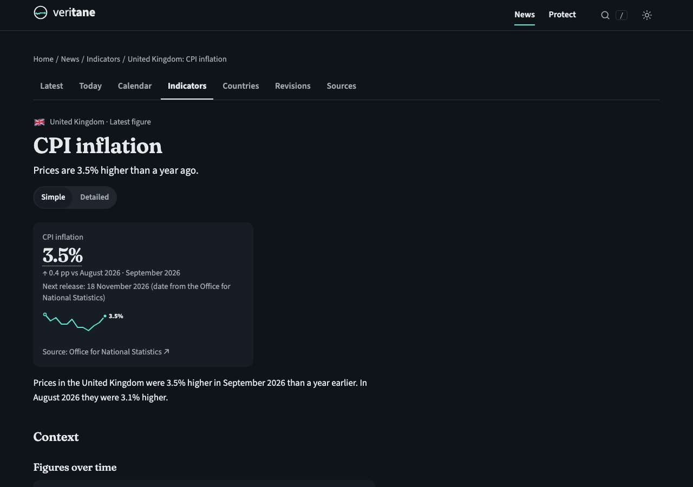

# Veritane News

### Economic news with receipts.

**Every number checked against the official dataset, put in context, and translated into what it means for your money.**
Free · No ads · No accounts · No tracking

[**Open Veritane News →**](https://william-lindberg.github.io/veritane/)

[Today in the economy](https://william-lindberg.github.io/veritane/news/today/) ·
[Economic calendar](https://william-lindberg.github.io/veritane/news/calendar/) ·
[Countries](https://william-lindberg.github.io/veritane/news/countries/) ·
[Free calculators](https://william-lindberg.github.io/veritane/tools/) ·
[Money Manager](https://william-lindberg.github.io/veritane/manager/) ·
[Scam warnings](https://william-lindberg.github.io/veritane/protect/)

 

---

## What makes it different

| | |
|---|---|
| 🧾 **Receipts on every number** | Each figure links to the exact official dataset it came from: central banks, statistics offices, the IMF and the World Bank. Check it yourself in one click. |
| 💶 **What it means for you** | News about interest rates, inflation or exchange rates comes with a small calculator: *"On a 200,000 loan, this changes your monthly payment by +29.32."* |
| 🔍 **Simple or Detailed** | Every story in plain language, or with full definitions, dataset codes and methods. One switch. |
| 📈 **Context, not just headlines** | 10-year charts, official targets (such as a 2% inflation target) and comparisons with other countries. |
| ⚖️ **Neutral by design** | Fixed, published wording rules. No "plunge", no "soar", no opinions, no advice. Revisions to official figures are logged publicly. |

## What's inside

- **Economic news** from about 56 official sources, refreshed automatically several times a day
- **238 data series for 39 countries and areas:** inflation, interest rates, unemployment, GDP growth, exchange rates, bond yields, IMF forecasts
- **Today in the economy** (a daily summary) and an **economic calendar** of upcoming official releases
- **Country pages** and a **world map** you can explore
- **39 free calculators:** loans, mortgages, savings, inflation, rent vs buy, retirement, debt payoff and more
- **Money Manager:** budget, savings goals, debts and net worth, stored only on your own device
- **108 plain-language explainers** and a **342-term glossary**
- **24 guides** on scams and consumer rights

<table>
<tr>
<td width="50%"></td>
<td width="50%"></td>
</tr>
<tr>
<td align="center"><b>Charts you can explore:</b> hover, tap or use the arrow keys</td>
<td align="center"><b>The world at a glance:</b> inflation and interest rates by country</td>
</tr>
<tr>
<td></td>
<td align="center"></td>
</tr>
<tr>
<td align="center"><b>Every number with its source</b></td>
<td align="center"><b>Made for phones too</b></td>
</tr>
</table>

## Apps

Windows and Android apps are on the way. They'll appear under [**Releases**](https://github.com/William-Lindberg/veritane/releases).

## How the news is made

Software reads official releases from central banks, statistics offices and international organisations, and writes neutral summaries from the published numbers using fixed templates. Every item links to its source. Read the [editorial standards](https://william-lindberg.github.io/veritane/about/editorial-standards/), the [wording rules](https://william-lindberg.github.io/veritane/about/wording-rules/) and the [corrections log](https://william-lindberg.github.io/veritane/about/corrections/).

## Found a mistake?

Please [open an issue](https://github.com/William-Lindberg/veritane/issues/new). Corrections are published openly.

---

Veritane News is a free, student-led, volunteer project of The Veritane Foundation. This repository hosts the published website and app downloads.
© 2026 The Veritane Foundation. Free to use. Educational information only, not financial advice.
Data © the official publishers named next to each figure. Map shapes: Natural Earth (public domain).
