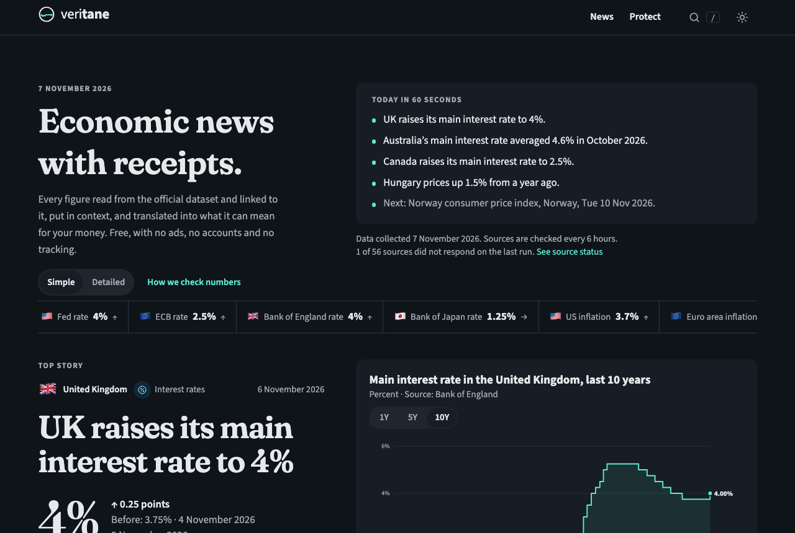
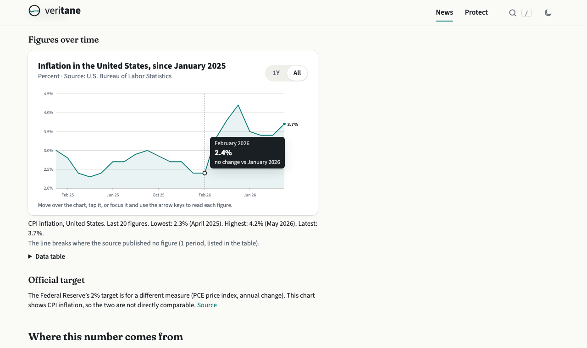
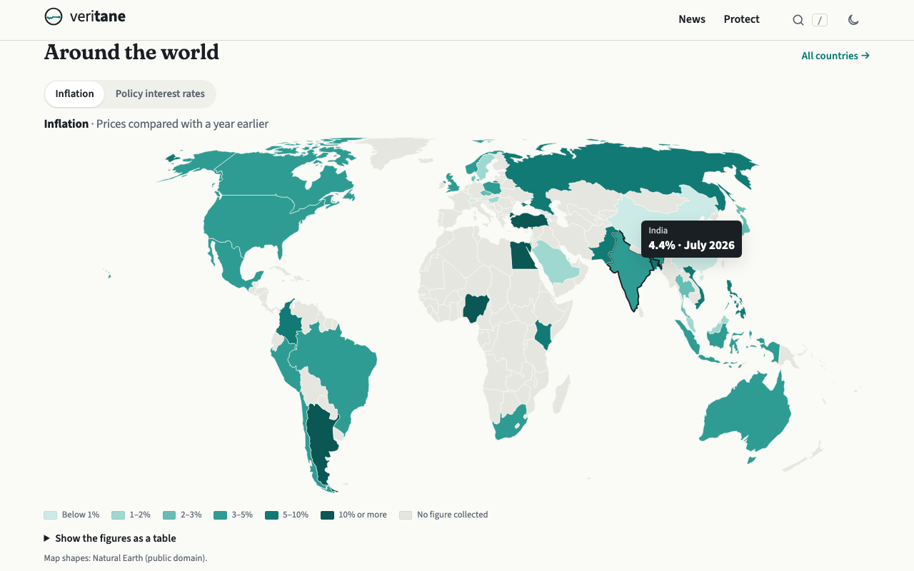
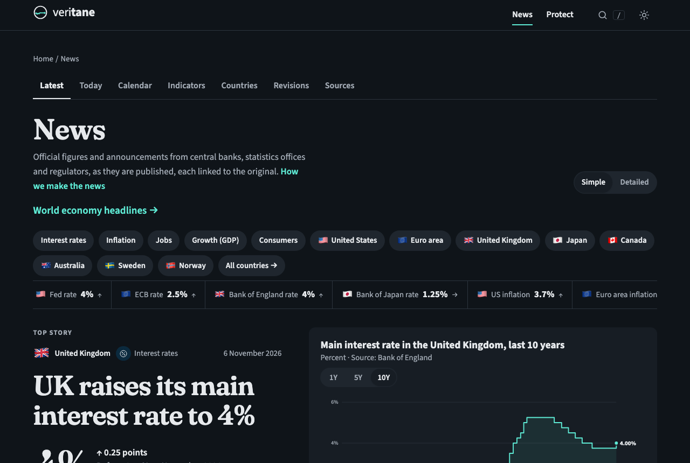
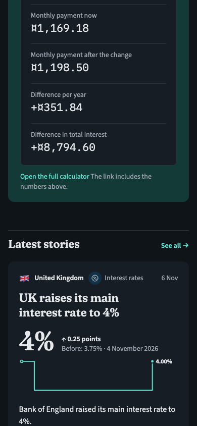

# Veritane News

### World news, checked. Explained for your money.

**What happens in the world (wars, elections, central banks, prices) written neutrally from several independent sources, with every number checked against the official data and what it means for you.**
Free · No ads · No accounts · No tracking · Website, Windows and Android

[**Open Veritane News →**](https://william-lindberg.github.io/veritane/) &nbsp;·&nbsp; [**Download the apps →**](https://github.com/William-Lindberg/veritane/releases/latest)

[World news](https://william-lindberg.github.io/veritane/news/world/) ·
[World map](https://william-lindberg.github.io/veritane/news/map/) ·
[Today in the economy](https://william-lindberg.github.io/veritane/news/today/) ·
[Economic calendar](https://william-lindberg.github.io/veritane/news/calendar/) ·
[Countries](https://william-lindberg.github.io/veritane/news/countries/) ·
[Free calculators](https://william-lindberg.github.io/veritane/tools/) ·
[Money Manager](https://william-lindberg.github.io/veritane/manager/) ·
[Scam warnings](https://william-lindberg.github.io/veritane/protect/)

 

---

## What makes it different

| | |
|---|---|
| 🌍 **The world's news, not one country's** | Stories are found across 321 outlets in 64 countries and many languages, grouped by event and balanced so that no single country dominates the front page. |
| 🤝 **Several sources before a story** | A story is written only when at least three independent outlet groups report it (and two countries for conflicts and politics), in Veritane's own words. Every claim is marked as confirmed, reported or disputed. |
| 🧾 **Receipts on every number** | Each figure links to the exact official dataset it came from: central banks, statistics offices, the IMF and the World Bank. Check it yourself in one click. |
| 💶 **What it means for you** | News about interest rates, inflation or exchange rates comes with a small calculator: *"On a 200,000 loan, this changes your monthly payment by +29.32."* |
| 🔍 **Simple or Detailed** | Every story in plain language, or with full definitions, sources and methods. One switch. |
| ⚖️ **Neutral by design** | Fixed, published wording rules. Every side attributed, no predictions, no "plunge" or "soar", no opinions, no advice. Corrections and revisions are logged publicly. |

## What's inside

- **World news**: the day's biggest events and why they matter for the economy, refreshed every few hours, with a world news map, event trackers and an attention tracker
- **Official figures** from about 57 official sources: **1,189 data series for 52 countries and areas** (inflation, interest rates, unemployment, GDP, wages, house prices, energy and commodity prices, exchange rates, bond yields, IMF forecasts)
- **Central bank tracker**, **prices where you live**, **Today in the economy** and an **economic calendar** of upcoming releases
- **Breaking-news alerts** in the apps (opt-in, calm wording, no tracking)
- **45 free calculators**: loans, mortgages, savings, inflation, rent vs buy, retirement, debt payoff and more
- **Money Manager**: budget, savings goals, debts and net worth, stored only on your own device
- **109 plain-language explainers** and a **342-term glossary**
- **24 guides** on scams and consumer rights
- In **English** and **Swedish** (Italian coming soon)

<table>
<tr>
<td width="50%"></td>
<td width="50%"></td>
</tr>
<tr>
<td align="center"><b>Charts you can explore:</b> hover, tap or use the arrow keys</td>
<td align="center"><b>The world at a glance</b></td>
</tr>
<tr>
<td></td>
<td align="center"></td>
</tr>
<tr>
<td align="center"><b>World stories, grouped by event</b></td>
<td align="center"><b>Made for phones too</b></td>
</tr>
</table>

## Apps

**Version 0.1.0 is out.** [**Download it from Releases →**](https://github.com/William-Lindberg/veritane/releases/latest)

| | File | Note |
|---|---|---|
| 🪟 **Windows** | `veritane-0.1.0-x64-setup.exe` (or `.msi`) | Not code-signed yet: Windows may show "Windows protected your PC". Click **More info → Run anyway**. |
| 🤖 **Android** | `veritane-0.1.0-android-debug.apk` | Not on the Play Store yet: allow "Install unknown apps" for your browser, then open the file. |

Each release lists SHA-256 checksums (`SHA256SUMS`) so you can verify your download. [How to check](https://william-lindberg.github.io/veritane/about/releases/).

## How the news is made

Software watches world news coverage and official releases from central banks, statistics offices and international organisations. Reports of the same event are grouped, checked against each other and against official data, and written up neutrally in Veritane's own words, with a Simple and a Detailed version. Read the [editorial standards](https://william-lindberg.github.io/veritane/about/editorial-standards/), the [wording rules](https://william-lindberg.github.io/veritane/about/wording-rules/), [how ranking works](https://william-lindberg.github.io/veritane/about/how-ranking-works/) and the [corrections log](https://william-lindberg.github.io/veritane/about/corrections/).

## Found a mistake?

Please [open an issue](https://github.com/William-Lindberg/veritane/issues/new). Corrections are published openly.

---

Veritane News is a free, student-led, volunteer project of The Veritane Foundation. This repository hosts the published website and app downloads.
© 2026 The Veritane Foundation. Free to use. Educational information only, not financial advice.
Data © the official publishers named next to each figure. Map shapes: Natural Earth (public domain).
